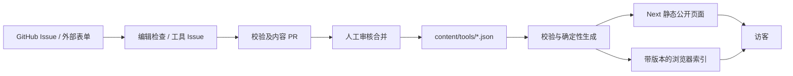

# 内容驱动的 Catalog 架构

本次重构将工具目录、提交审核和站点展示分开。日常修改工具只涉及一个文件和一次构建，不再判断数据库和本地快照哪个覆盖哪个。

## 内容与模块边界

- `content/tools` 保存一个工具的全部公开信息，包括详情与编辑内容；禁止账户、投稿邮箱和后台状态等字段。
- `features/catalog/types.ts` 定义内容记录和卡片摘要两种边界。页面不能把详情记录当列表摘要传给浏览器。
- `taxonomy.ts` 是分类的唯一来源。子分类使用稳定 key；一些用途可以跨大类，显式记录 `parents`，避免改名破坏匹配。
- `validation.ts` 校验字段、HTTP(S) 地址、slug、分类、日期、重复 slug 与规范化后的官网地址。校验失败会终止构建，不会回退到另一份内容。
- `server.ts` 仅读取本次构建生成的快照，并用 Map 按 slug 查详情。通过 `server-only` 防止内容读取代码进入浏览器。
- `query.ts` 是纯查询模块：排序、筛选、合法查询参数及 24 条分页，服务端和浏览器共用相同规则。
- `seo.ts` 单独处理详情页标题和摘要；页面文件保留展示结构。

## 页面与性能

首页、工具列表、大类/子分类和工具详情在生产构建时生成。公开导航不读取 cookie 或会话，保持页面可缓存。动态工具 OG 图片仍由 Next 提供，读取同一快照；图片优化与历史跳转也保留，所以未强制使用 `output: export`。

工具列表初次 HTML 只包含 24 条公开摘要，结构化列表与当前首屏一致。分页、分类或排序变更时按需加载卡片索引；输入搜索词时额外加载文本索引。卡片索引没有详情正文、编辑内容、邮箱、数据库 ID 或审核状态。搜索文本仅保存用于匹配的描述与标签文本。

索引 URL 带内容哈希，设置长期 immutable 缓存；页面与索引引用同一版本，避免新旧内容混用。索引失败显示可重试状态，查询词和分页保存在 URL，支持刷新、分享与前进/后退。

`/tools?category=...` 等旧入口继续工作。分类页与详情保留已有 canonical、站点地图和根目录旧 slug 的永久跳转。未知发布时间保持为空；没有新造的“最新发布”时间。

## 投稿与审核

代码仓库已公开，默认投稿和纠错入口使用本仓库的 Issue 模板，访客通过 GitHub 提交资料。入口仍可配置为外部表单或邮件；编辑将外部资料整理为内容 PR 或工具 Issue。一般联系邮箱继续保留。

工具 Issue 由有权限的编辑加 `catalog:accepted` 标签后才触发自动化。输入只作为 JSON 字段解析，不用于执行命令；创建 PR 前完成校验、测试、类型检查与构建。工作流只创建审阅分支和 PR，最终发布依赖人工合并与现有 Git 部署。

自动校验确认格式与重复情况；产品真实性、网站是否正常和编辑判断由人工负责。更正 Issue 由编辑更新原内容文件，防止自动修改既有 slug 或未经确认的审核标记。

## 迁移与回退

完整分页读取旧数据库，核对 2,518 个已批准工具与快照，slug 和公开内容一致。迁移保留 117 个验证标记/真实发布时间、17 个精选标记以及四个工具的编辑内容；没有创建额外公开记录。旧字符串 `None` 子分类规范为空，跨类用途保留原大类并在 taxonomy 中显式允许。

原整库 JSON、独立编辑 JSON、手动 slug 索引、数据库导入/回填/流量脚本及运行时鉴权/邮件代码退出活动代码树。历史 SQL 留存；远程数据库没有做任何删除。

迁移在 `refactor/content-catalog` 分支中。回退使用部署平台的前一版本或 Git 历史恢复旧应用；不得把历史数据库重新接成当前目录的隐式备用源。内容误改可以恢复单个工具文件并重新构建。

`PLAN.md` 及早期发布记录属于历史背景；当前维护入口以 README 和本文为准。
